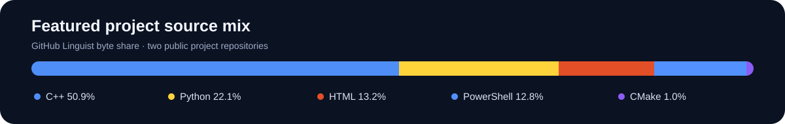

  

  <strong>B.Tech Engineering Physics · NIT Hamirpur · Expected 2028</strong> 
  CGPA 7.71/10

  I turn physical models into clear, reproducible software. 
  My current projects explore quantum simulation and topological matter.

  <a href="https://github.com/Ajandeep-singh">GitHub</a> ·
  <a href="https://www.linkedin.com/in/ajandeep-singh-a58909346">LinkedIn</a>

---

## Research & computational physics

### [SSH Topological Edge States Under Disorder](https://github.com/Ajandeep-singh/ssh-topological-edge-states)

A Python study of edge-state candidates in finite SSH chains with hopping and on-site disorder. The project includes a fixed-seed 6,600-realization sweep, CSV data, spectra and localization plots, and a research report. Its edge-state measures are finite-chain diagnostics, not topological invariants.

**Python · NumPy · Pandas · Matplotlib**

## Scientific software

### [QuantumSim-Cpp](https://github.com/Ajandeep-singh/QuantumSim-Cpp)

A C++17 pure state-vector simulator with gate and circuit operations, measurement, and Bell/GHZ examples. It includes analytical and randomized validation tests and reproducible performance benchmarks.

**C++17 · CMake · numerical validation · benchmarking**

## Technical toolkit

  <code>C++17</code> <code>Python</code> <code>NumPy</code> <code>Pandas</code> <code>Matplotlib</code> <code>CMake</code> <code>Git</code> <code>PowerShell</code>

**Methods:** state-vector simulation · Hamiltonian modeling · disorder ensembles · numerical checks · reproducible experiments

## Repository language mix

  

*GitHub-reported language bytes for the two featured projects, checked 22 October 2026. This describes tracked repository contents, not proficiency; the chart is a static snapshot.*

## Current focus

Building deeper scientific programming skills and exploring computational methods for quantum systems and topological matter. Interested in research internships involving simulation, numerical modeling, or scientific software.

---

Engineering Physics × Computational Science × Software

